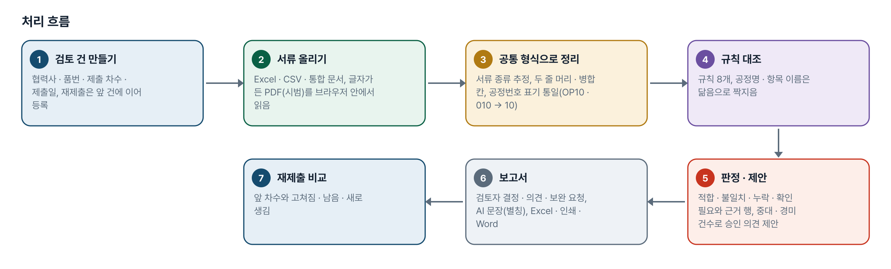
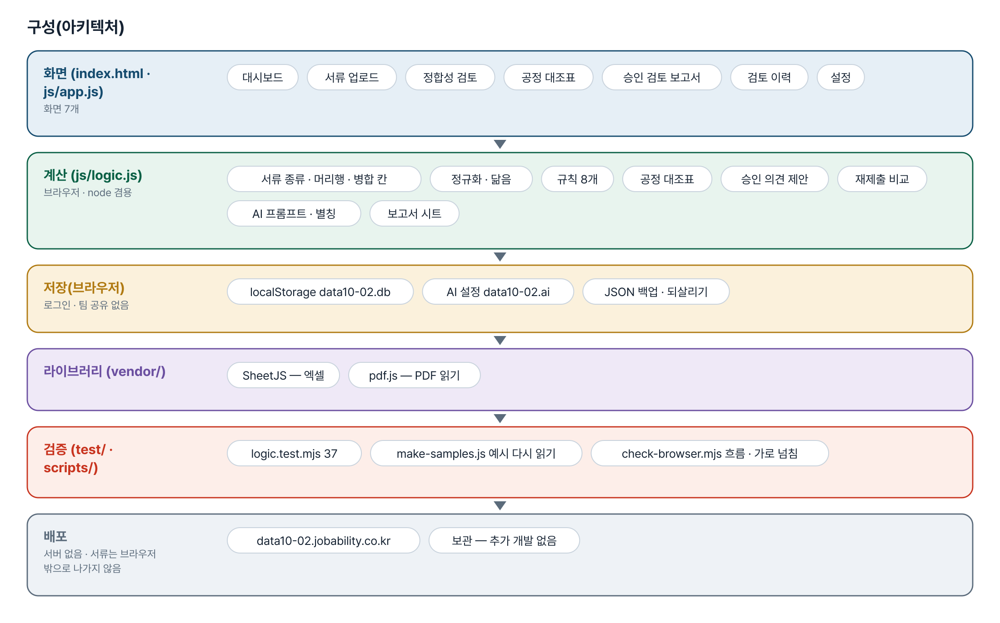
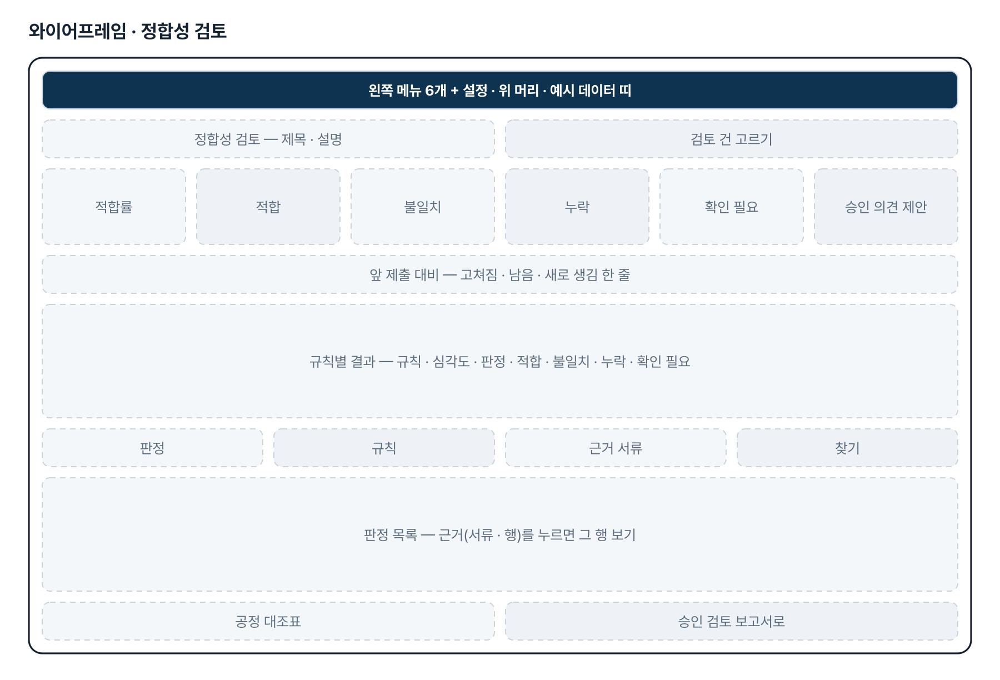
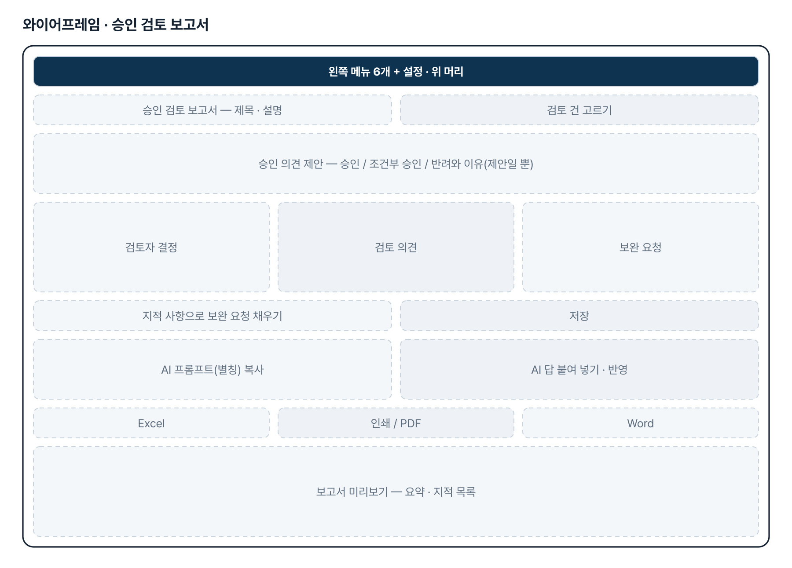
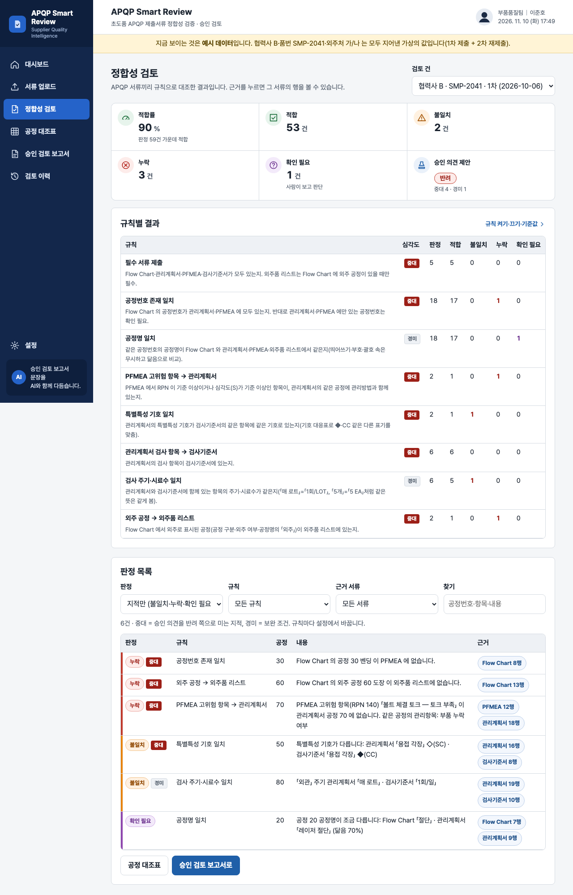

# APQP Smart Review — 프로젝트 기획서 v1.1

- 기획: 이준호 · 작성일 2026-11-10 · 현장 데이터 디지털화 전문가과정 · 2차수 프로젝트 02
- 바로 쓰기: https://data10-02.jobability.co.kr/
- 워드 판: `docs/기획서/data10-02_이준호_APQPSmartReview_기획서_v1.1.docx`

## 개요

협력사 초도품 APQP 서류(Flow Chart · 관리계획서 · PFMEA · 검사기준서 · 외주품 리스트)를 올리면 서류끼리 공정 · 관리항목을 규칙으로 대조해 누락 · 불일치 · 확인 필요 목록과 승인 의견 제안을 내고, 승인 검토 보고서와 재제출 비교까지 만드는 브라우저 도구입니다. 2026-10-21 제출자 요청으로 보관한 과제입니다.

### 배경 · 현재 업무
- 부품품질팀은 협력사가 초도품 승인을 위해 내는 APQP 서류 5종을 검토해 승인 여부를 정합니다.
- 서류는 엑셀 또는 PDF 로 들어오고, 서류끼리 공정번호 · 공정명 · 관리항목 · 특별특성 · 검사 주기가 맞는지를 사람이 눈으로 대조하는 것으로 보았습니다(가정).
- 서류와 행이 많아 누락 · 불일치를 빠뜨리기 쉽고, 검토자마다 기준이 달라질 수 있습니다(가정).
- 반려 뒤 재제출을 받으면 앞 지적이 고쳐졌는지 처음부터 다시 확인해야 합니다(가정).
- 실제 서류 · 대조 규칙 · 보고서 양식은 받지 못했습니다. 1단계는 가상 서류(협력사 B · 품번 SMP-2041)로 만들었고, 2026-10-21 제출자 요청으로 과제를 보관했습니다.

### 목표
- 품번 하나의 서류 세트를 올리면 문서 간 공정 · 관리항목 정합성 판정이 나옵니다.
- 누락 · 불일치 · 확인 필요 목록에 근거 서류 · 행을 함께 남깁니다.
- 승인 의견을 제안(승인 / 조건부 승인 / 반려)하고, 검토자 결정과 함께 승인 검토 보고서로 냅니다.
- 재제출 때 앞 차수와 비교해 고쳐짐 · 남음 · 새로 생김을 보여 줍니다.

## 요구사항과 구현

| 기획서 요구 | 구현 |
|---|---|
| 문서 간 공정 · 관리항목 정합성 평가 | 시작 규칙 8개(켜기 · 끄기 · 심각도 · 기준값) → 적합 · 불일치 · 누락 · 확인 필요, 적합률. 기준값은 가정 |
| 누락 · 불일치 · 확인 필요사항 목록 | 판정 목록(판정 · 규칙 · 근거 서류 거르기, 근거 행 보기), 공정 × 서류 대조표 |
| APQP 승인 검토 보고서 | 승인 의견 제안 + 검토자 결정 · 의견 · 보완 요청, AI 문장(반자동), Excel · 인쇄/PDF · Word(.doc). 회사 양식은 받지 못해 기본 양식 |
| 엑셀 서류 | Excel · CSV · 여러 시트 통합 문서, 서류 종류 추정, 머리행 · 두 줄 머리 · 병합 칸, 열 직접 고르기(기억) |
| PDF 서류 | 글자가 든 PDF 만 시범으로 읽음. 스캔본(OCR) · DRM 파일은 못 읽음 — 미구현 |
| 재제출 확인 | 같은 협력사 · 품번의 앞 차수와 비교(고쳐짐 · 남음 · 새로 생김) |
| 팀 공유 · 협력사 품질 포털(기획서 2단계) | 미구현 — 브라우저마다 따로 저장, JSON 백업으로 옮김 |
| 실제 서류 · 대조 규칙 · 보고서 양식 반영 | 미구현 — 자료를 받기 전에 보관 |

## 주요 기능

- **대시보드** — 검토 품번 · 열린 지적 · 반려 제안 · 평균 적합률, 최근 검토 건, 규칙별 열린 지적, 일하는 순서를 보여 줍니다.
- **서류 업로드** — 검토 건(협력사 · 품번 · 제출 차수)을 만들고 서류를 올립니다. 서류 종류 · 머리행 · 열을 자동으로 맞추고 정리 결과를 미리 봅니다.
- **정합성 검토** — 적합률 · 판정 건수 · 승인 의견 제안, 규칙별 결과, 판정 목록을 보여 줍니다. 근거를 누르면 그 서류의 행을 봅니다.
- **공정 대조표** — 공정 × 서류 표로 있음 · 누락 · Flow 에 없음 · 대상 아님과 공정명이 다른 칸을 표시합니다.
- **승인 검토 보고서** — 검토자 결정 · 의견 · 보완 요청을 적고 Excel · 인쇄 · Word 로 냅니다. AI 프롬프트에는 협력사 · 외주처 · 품번을 별칭으로 가립니다(기본).
- **검토 이력** — 품번별 제출 차수 · 적합률 · 지적 · 결정과 앞 차수 비교를 보여 줍니다.
- **설정** — 규칙 켜기 · 끄기 · 심각도 · 기준값, 승인 의견 제안 기준, 별칭 가리기, AI 연결, JSON 백업 · 되살리기.

## 처리 흐름(파이프라인)

1. **검토 건 만들기** — 협력사 · 품번 · 제출 차수 · 제출일, 재제출은 앞 건에 이어 등록
2. **서류 올리기** — Excel · CSV · 통합 문서, 글자가 든 PDF(시범)를 브라우저 안에서 읽음
3. **공통 형식으로 정리** — 서류 종류 추정, 두 줄 머리 · 병합 칸, 공정번호 표기 통일(OP10 · 010 → 10)
4. **규칙 대조** — 규칙 8개, 공정명 · 항목 이름은 닮음으로 짝지음
5. **판정 · 제안** — 적합 · 불일치 · 누락 · 확인 필요와 근거 행, 중대 · 경미 건수로 승인 의견 제안
6. **보고서** — 검토자 결정 · 의견 · 보완 요청, AI 문장(별칭), Excel · 인쇄 · Word
7. **재제출 비교** — 앞 차수와 고쳐짐 · 남음 · 새로 생김

## 구성(아키텍처)

- **화면 (index.html · js/app.js)** — 대시보드 · 서류 업로드 · 정합성 검토 · 공정 대조표 · 승인 검토 보고서 · 검토 이력 · 설정
- **계산 (js/logic.js)** — 서류 종류 · 머리행 · 병합 칸 · 정규화 · 닮음 · 규칙 8개 · 공정 대조표 · 승인 의견 제안 · 재제출 비교 · AI 프롬프트 · 별칭 · 보고서 시트
- **저장(브라우저)** — localStorage data10-02.db · AI 설정 data10-02.ai · JSON 백업 · 되살리기
- **라이브러리 (vendor/)** — SheetJS — 엑셀 · pdf.js — PDF 읽기
- **검증 (test/ · scripts/)** — logic.test.mjs 37 · make-samples.js 예시 다시 읽기 · check-browser.mjs 흐름 · 가로 넘침
- **배포** — data10-02.jobability.co.kr · 보관 — 추가 개발 없음

## 화면 구성(와이어프레임)

## 규칙 · 판정 기준

- 모든 서류를 공통 형식(공정번호 · 공정명 · 특성 · 특별특성 · 관리/검사방법 · 주기 · 시료수 · S/O/D/RPN)으로 바꾼 뒤 대조합니다. 공정번호는 「OP10」 「010」 「공정 10」을 「10」으로 맞춥니다.
- 규칙 8개 — 필수 서류 제출 · 공정번호 존재 일치 · 공정명 일치 · PFMEA 고위험 항목 → 관리계획서 · 특별특성 기호 일치 · 관리계획서 검사 항목 → 검사기준서 · 검사 주기 · 시료수 일치 · 외주 공정 → 외주품 리스트.
- 공정명은 닮음 80% 이상 적합 · 50% 이상 확인 필요 · 그 아래 불일치. 이동 · 운반 · 보관 · 대기 · 저장 공정은 대조에서 뺍니다.
- PFMEA 고위험 = RPN 100 이상 또는 심각도 S 9 이상. 주기 · 시료수는 같은 뜻을 같게 봅니다(「매 로트」 = 「1회/LOT」, 「5개」 = 「5 EA」).
- 승인 의견 제안 — 중대 지적 1건 이상 또는 경미 지적 6건 이상이면 반려, 지적 · 확인 필요가 있으면 조건부 승인, 없으면 승인. 최종 결정은 검토자가 합니다.
- 기준값 · 심각도 · 제안 기준은 실제 규칙을 받기 전의 가정이며, 설정에서 바꿉니다.

## 검증

- 계산 규칙 테스트 37개 통과
- 2026-11-10 node test/logic.test.mjs 를 다시 돌려 37개 모두 통과를 확인했습니다.
- 1단계 때 로직을 일부러 10가지로 깨뜨려 시험이 모두 실패로 잡는지 확인했습니다(처음 7가지만 잡혀 시험 3개를 더함).
- 예시 1차 제출은 반려(지적 6건), 2차 재제출은 조건부 승인(고쳐짐 5 · 남음 1)으로 나옵니다.
- 브라우저 흐름 점검(scripts/check-browser.mjs)은 선택 실행이라 자동 시험 수에 넣지 않았습니다.

## 이번 판에서 하지 않는 것

- 보관 처리 — 로그인 · 팀 공유 저장 없음, 추가 개발 보류(2026-10-21 제출자 요청).
- 실제 APQP 서류 · 회사 대조 규칙 · 보고서 양식을 받지 못해 열 이름 사전 · 기준값은 가정입니다.
- 스캔 PDF(OCR) · DRM 파일은 읽지 못합니다. 글자가 든 PDF 도 시범이라 미리보기 확인이 필요합니다.
- 자료는 각자의 브라우저에 저장합니다. 옮길 때는 JSON 백업을 씁니다.
- 과제 07(data10-07)과 협력사 품질 포털로 묶지 않았습니다.

## 다음 단계

- 재개는 제출자가 기준을 보완해 다시 올리면 새 접수로 받습니다(이 리포는 보관 그대로).
- 재개 시 실제 서류 한 세트로 열 이름 · 두 줄 머리 · 시트 구성을 확인하고 사전을 보정합니다.
- 회사의 「정합」 대조 규칙 · 반려 기준과 보고서 양식 · 과거 반려 사유를 반영합니다.
- PDF 비율 · DRM 조건 확인 뒤 PDF 읽기 강화 · 스캔본 OCR.
- 로그인 · 팀 공유 저장, 과제 07 과 협력사 품질 포털로 묶기.

## 버전 이력

- **v1.1** (2026-11-10) — 현 상태 최종 기획서 정리(보관 과제, 추가 개발 없음) / 보관 처리(2026-10-21) · 저장소 비공개 전환(2026-10-26) 반영
- **v1.0** (2026-10-20) — 1단계 개발 — 업로드 · 규칙 8개 대조 · 판정 목록 · 공정 대조표 · 승인 검토 보고서 · 재제출 비교
- **v0.1** (2026-10-20) — 기획서 초안 — 수강생 제출 자료 기반
